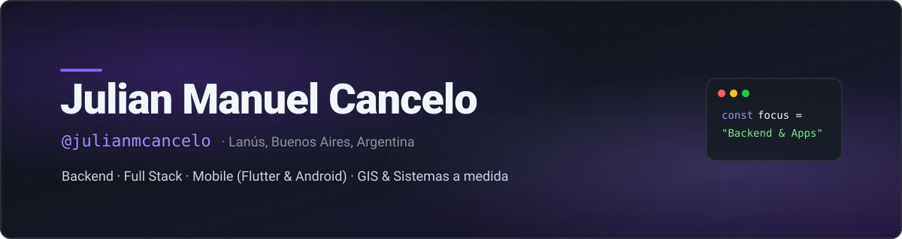
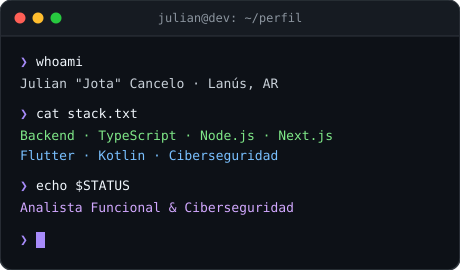

<!-- Perfil GitHub julianmcancelo | Tema: Portfolio técnico · Dark / Violet -->

  

  <h2>Back-End Developer · Analista Funcional · Ciberdefensa</h2>

  

    Construyo soluciones de software de punta a punta: desde APIs y plataformas web hasta aplicaciones móviles, herramientas GIS y sistemas seguros a medida.
  

  

  

    <a href="#perfil">Perfil</a> &nbsp;·&nbsp;
    <a href="#tecnologías">Tecnologías</a> &nbsp;·&nbsp;
    <a href="#proyectos-destacados">Proyectos</a> &nbsp;·&nbsp;
    <a href="#actividad-en-github">Actividad</a> &nbsp;·&nbsp;
    <a href="#contacto">Contacto</a>
  

---

## 👤 Perfil

<table width="100%">
  <tr>
    <td width="57%" valign="top">
      
Soy <strong>Julian Manuel Cancelo</strong> (<em>Jota</em>), desarrollador de <strong>Lanús, Buenos Aires, Argentina</strong>, apasionado por el desarrollo <strong>Back-End</strong> y la seguridad informática.

      
Combino mi formación como <strong>Analista Funcional</strong> y en <strong>Ciberdefensa</strong> con el desarrollo de plataformas web (<strong>Next.js</strong>, <strong>React</strong>, <strong>Node.js</strong>, <strong>TypeScript</strong>) y apps móviles en <strong>Flutter</strong> y <strong>React Native</strong>.

      
<strong>Áreas de interés:</strong> arquitectura backend, seguridad ofensiva/defensiva, análisis de sistemas, apps móviles y librerías open source.

    </td>
    <td width="43%" valign="middle" align="center">
      
    </td>
  </tr>
</table>

---

## 🧰 Tecnologías

Lenguajes, frameworks y herramientas que uso en mis proyectos.

<table width="100%">
  <tr>
    <td width="50%" valign="top">
      <h3>Lenguajes</h3>
      
      
      
      
      
    </td>
    <td width="50%" valign="top">
      <h3>Desarrollo web y backend</h3>
      
      
      
      
    </td>
  </tr>
  <tr>
    <td width="50%" valign="top">
      <h3>Datos e infraestructura</h3>
      
      
      
      
      
    </td>
    <td width="50%" valign="top">
      <h3>Mobile y Seguridad</h3>
      
      
      
      
      
    </td>
  </tr>
</table>

---

## 🚀 Proyectos destacados

<table width="100%">
  <tr>
    <td width="50%" valign="top">
      <h3><a href="https://github.com/julianmcancelo/Sigic">Sigic ↗</a></h3>
      
Sistema de Gestión Integral de Colación y Ceremonias: plataforma Next.js + React, API serverless, credencial QR, editor de anfiteatro y app Flutter.

      
      
    </td>
    <td width="50%" valign="top">
      <h3><a href="https://github.com/julianmcancelo/fullpack">Fullpack ↗</a></h3>
      
Gestión integral de Mercado Libre: control de stock, ventas, logística con etiquetas, terminal de depósito web y app Android con escáner en ráfaga.

      
      
    </td>
  </tr>
  <tr>
    <td width="50%" valign="top">
      <h3><a href="https://github.com/julianmcancelo/recicla-sur">Recicla Sur ↗</a></h3>
      
Ecosistema Integral de Reciclaje Comunitario, Economía Circular y Beneficios Locales desarrollado para el Desafío Beltrán 2026 ITB.

      
      
    </td>
    <td width="50%" valign="top">
      <h3><a href="https://github.com/julianmcancelo/google-wallet">Google Wallet SDK ↗</a></h3>
      
Librería tipada y 100% en español para crear, firmar y emitir pases de Google Wallet en Node.js, Next.js y React.

      
      
    </td>
  </tr>
</table>

<a href="https://github.com/julianmcancelo?tab=repositories">Explorar todos los repositorios →</a>

---

## 📊 Actividad en GitHub

  
  
  
<a href="https://github.com/julianmcancelo?tab=overview">Ver contribuciones en GitHub →</a>

---

## 🤝 Contacto

  
  

 

  
  
Julian Manuel Cancelo · Lanús, Buenos Aires, Argentina

